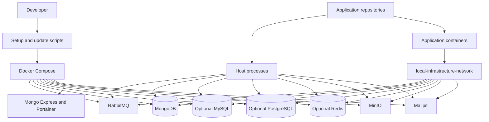

# Local Infrastructure
[Español](README.md)

`local-infrastructure` is a reusable orchestration layer for local development environments. It provides shared Docker services, environment configuration, repository bootstrap utilities, and operational documentation without coupling the environment to a particular application, organization, or technology stack.

Application repositories remain independent. They can use any runtime and are stored locally under `repositorios/` when managed from this workspace.

## Overview

```text
Application repositories
        |
        v
Local Infrastructure
        |
        +-- RabbitMQ
        +-- MongoDB
        +-- MinIO
        +-- Mailpit
        +-- Development tools
```

The root Compose configuration runs only shared backing services. Application containers, source code, build contexts, and framework commands belong to their respective repositories.

## Features

- Docker Compose orchestration for shared local services
- Persistent Docker volumes for stateful services
- Local-only port bindings
- Generated development credentials stored in an ignored `.env` file
- Bash setup workflow for WSL and Linux
- Optional cloning of application repositories into `repositorios/`
- Safe Git update workflow for repositories with configured upstream branches
- Shared Docker network for containerized applications
- Service health checks for RabbitMQ, MongoDB, and MinIO
- Optional MySQL, PostgreSQL, and Redis for applications needing SQL or caching

## Requirements

- WSL or Linux with Bash
- `sudo` access and internet connectivity for an initial automatic installation
- Ubuntu 22.04+ or Debian 12+, with glibc 2.35+ and x86_64 or aarch64 architecture, for this branch's isolated PHP runtime

The same `setup-local.sh` workflow runs in WSL and Linux. On Debian or Ubuntu, it installs missing Git, Docker Engine, and the Docker Compose plugin, then starts Docker Engine. If the tools already exist, it validates them without reinstalling anything.

On this branch, PHP is built with a fixed `ubuntu:22.04` base, not the workstation's release. Setup checks the distribution, glibc, and architecture before downloading phpenv and exits with a clear message when they are incompatible. This prevents newer workstations from introducing libraries or compilers incompatible with PHP 8.3.6.

On Windows, install a Debian or Ubuntu WSL distribution first and run setup inside it. The script installs Docker Engine in that distribution if needed; it does not use a Windows-hosted container runtime. This branch also prepares PHP 8.3.6 with phpenv under `enviroment/phpenv/`; it does not install application dependencies or frameworks.

## Repository Structure

```text
local-infrastructure/
├── .env.example
├── .gitattributes
├── .gitignore
├── AGENTS.md
├── README.en.md
├── README.md
├── docker-compose.yml
├── docker-compose.mysql.yml
├── docker-compose.postgres.yml
├── docker-compose.redis.yml
├── docs/
│   ├── application-repositories.md
│   ├── direct-upload-architecture.md
│   ├── internationalization.md
│   ├── local-services.md
│   └── timezone-handling.md
├── enviroment/
│   ├── activate.sh
│   ├── build-php.sh
│   ├── check-phpenv.sh
│   ├── copy-runtime-libraries.sh
│   ├── php-build.Dockerfile
│   └── setup-phpenv.sh
├── repositorios/
│   └── .gitkeep
├── setup-local.sh
└── update-local.sh
```

## Quick Start

```bash
git clone <repository-url>
cd local-infrastructure
bash ./setup-local.sh
```

The setup script installs missing host prerequisites on supported distributions, prepares PHP 8.3.6 with phpenv, validates the Docker daemon, creates an ignored `.env` file with generated local credentials, and starts the shared services. It waits for services with health checks, including MinIO, to become healthy before reporting success. If one fails, it shows the current status and preserves data volumes.

To include optional services on the first run in WSL, add the flags you need. For example, to start all three:

```bash
bash ./setup-local.sh --with-mysql --with-postgres --with-redis
```

Each flag (`--with-mysql`, `--with-postgres`, `--with-redis`) is independent. Setup validates Compose and starts the six default services plus the selected ones; it does not install application dependencies.

### Empty, portable installations

On Linux or WSL, a deployment with new volumes starts the generic services **without application data**: it does not import databases, queues, buckets, messages, or another machine's Portainer configuration. Only each service's initial accounts and databases are created. These are shared instances per machine, not containers per application. To prepare all available services, use the three flags above without `--repository`.

Each machine generates its own private `.env` and then retains data in its local volumes. Do not copy `.env`, volumes, backups, or project data to distribute this template. If Docker already has volumes for the same Compose project, they are reused: **rerunning setup does not empty them**.

The Compose files can also be used directly on Linux or inside WSL with Docker Engine and Compose v2 installed, without this branch's PHP runtime. For that workflow, prepare a private `.env` from `.env.example`, add fresh random passwords for the eight password variables listed under [Environment Configuration](#environment-configuration), restrict its permissions to `600`, and use the Compose commands under [Starting the Environment](#starting-the-environment). This branch's automatic setup retains its additional Debian or Ubuntu requirement for preparing PHP.

If setup adds the current user to the `docker` group, open a new WSL or Linux session before running Docker commands without `sudo`. Until then, use the Docker command printed by setup.

To clone application repositories during setup, pass each repository with a local directory name:

```bash
bash ./setup-local.sh \
  --repository backend=<git-url> \
  --repository frontend=<git-url> \
  --repository landing=<git-url>
```

Each repository is cloned to `repositorios/<name>`. The script does not install application dependencies or start applications because those actions depend on each repository's technology and conventions.

### PHP 8.3.6 on this branch

`setup-local.sh` installs phpenv, php-build, and PHP 8.3.6 under `enviroment/phpenv/`. Git ignores that directory. It builds PHP in a temporary `ubuntu:22.04`-based container for the workstation's architecture and copies any missing runtime libraries into the local environment; it does not replace system PHP, install development packages on the host, or modify global Bash startup files. The first build can take several minutes. The build context excludes runtimes, logs, and other local files under `enviroment/`.

Builds use two parallel jobs by default. On a workstation with limited memory, use `PHP_BUILD_JOBS=1 bash ./setup-local.sh` or `PHP_BUILD_JOBS=1 bash ./update-local.sh`. Complete logs are retained under `enviroment/phpenv/logs/php-8.3.6.*/`, even after the container is removed. `build.log` contains the output and compiler, libxml2, and OpenSSL versions; `php-build.*.log` files retain compiler diagnostics. On failure, the script prints the local directory and the first matching errors. Review these logs before sharing them.

Activate this branch's version explicitly in a terminal:

```bash
source ./enviroment/activate.sh
php -v
# Run application PHP commands here.
deactivate_phpenv
```

Activation affects only that terminal. phpenv also installs Composer in this environment, so `composer install` uses the selected PHP when run from an application repository. Each application still owns its dependencies and environment files. See [Application Repositories](docs/application-repositories.md).

### Running a PHP or Laravel repository locally

This is a **local development** workflow, not a production deployment. First check the application's `composer.json`, `composer.lock`, and README to confirm that its dependencies support PHP 8.3.6 and to identify the services it needs. Laravel 8, if used by an application, was officially supported only through PHP 8.1 and stopped receiving security fixes on January 24, 2023. This branch does not make Laravel 8 compatible or safe for production: track the gap and plan an application upgrade before deploying outside local development. See the [Laravel 8 support policy](https://laravel.com/docs/8.x/releases).

Once compatibility is confirmed, prepare shared services from the infrastructure root and run each application from its own repository:

```bash
# Once, from the local-infrastructure root:
bash ./setup-local.sh                 # Add --with-mysql, --with-postgres, or --with-redis if needed.

# In each working terminal, from the local-infrastructure root:
source ./enviroment/activate.sh
php -v
cd repositorios/REPOSITORY_NAME
# Configure this application's private .env according to its README.
composer install
php artisan serve --host=127.0.0.1
```

Replace `REPOSITORY_NAME` with the actual directory name. `activate.sh` only selects PHP in the current shell; it does not start containers or install application dependencies. If shared services were set up earlier but are stopped, run `docker compose up -d` from the infrastructure root, including the same `-f` files used for optional services. Run migrations, tests, queue processes, and frontend commands only as directed by the application repository. A containerized application uses its own Compose file and the shared network; it does not need host PHP activation. See the detailed [PHP and Laravel local workflow](docs/php-laravel-local-workflow.md) (Spanish).

## Environment Configuration

`.env.example` contains non-sensitive configuration such as local ports, service usernames, and the shared Docker network name. `setup-local.sh` copies it to `.env` and appends generated passwords. If `.env` already exists, setup preserves its values and adds only missing optional settings.

Do not commit `.env`. To regenerate local credentials, reset the local service data, delete `.env`, then run setup again:

```bash
docker compose down --volumes
rm .env
bash ./setup-local.sh
```

If you started optional services, include their `-f` files in the first command to remove their volumes too. This permanently deletes local data: stateful services apply their initial credentials only when their data volumes are created.

The generated file contains values in this form:

```env
RABBITMQ_PASSWORD=<generated-local-password>
MONGODB_PASSWORD=<generated-local-password>
MONGO_EXPRESS_PASSWORD=<generated-local-password>
MINIO_ROOT_PASSWORD=<generated-local-password>
MYSQL_PASSWORD=<generated-local-password>
MYSQL_ROOT_PASSWORD=<generated-local-password>
POSTGRES_PASSWORD=<generated-local-password>
REDIS_PASSWORD=<generated-local-password>
```

MinIO starts without buckets or lifecycle rules. Applications create and configure the buckets they require.
Its image comes from Chainguard's public registry because `minio/minio` is no longer available on Docker Hub. The health check queries the HTTP endpoint using Bash; the minimal image does not include `curl`.

## First Access and Credentials

`setup-local.sh` creates `.env` only when it does not already exist. It copies the configured local usernames and generates the required passwords. For an existing `.env`, it adds only missing optional variables. No manual account creation is required for RabbitMQ, MongoDB, Mongo Express, MinIO, MySQL, PostgreSQL, or Redis on a clean setup.

Open `.env` only in a trusted local editor when a service or application requires its credentials. Do not print its contents in a terminal, share it, or commit it.

First-run flow:

1. Run `docker compose ps` and wait for the required service health checks. If setup reported temporary `sudo` access, use the command it printed instead.
2. Open `https://localhost:9443` and create the local Portainer administrator account.
3. Use the corresponding `.env` values when signing in to RabbitMQ, Mongo Express, or MinIO, or when configuring a MongoDB or RabbitMQ client.
4. Configure each application with the shared-service values it needs in that application's own ignored environment file.

| Service | First access | Credential source |
| --- | --- | --- |
| RabbitMQ | Sign in to the management UI or configure an AMQP client. | `RABBITMQ_USERNAME` and `RABBITMQ_PASSWORD` in `.env` |
| MongoDB | Configure an application or client with authenticated MongoDB access. | `MONGODB_USERNAME` and `MONGODB_PASSWORD` in `.env` |
| Mongo Express | Sign in through HTTP basic authentication. | `MONGO_EXPRESS_USERNAME` and `MONGO_EXPRESS_PASSWORD` in `.env` |
| MinIO | Sign in to the console or configure an S3-compatible client. | `MINIO_ROOT_USER` and `MINIO_ROOT_PASSWORD` in `.env` |
| MySQL (optional) | Configure a SQL client or application. | `MYSQL_USERNAME`, `MYSQL_PASSWORD`, `MYSQL_DATABASE`, and `MYSQL_PORT` in `.env` |
| PostgreSQL (optional) | Configure a SQL client or application. | `POSTGRES_USERNAME`, `POSTGRES_PASSWORD`, `POSTGRES_DATABASE`, and `POSTGRES_PORT` in `.env` |
| Redis (optional) | Configure a cache or messaging client. | `REDIS_PASSWORD` and `REDIS_PORT` in `.env` |
| Mailpit | Open the web UI or send mail through SMTP. | No authentication is configured. |
| Portainer | Open the HTTPS UI after the first startup and create its local administrator account. | Stored in the persistent `portainer_data` volume, not in `.env` |

Use placeholders, never generated values, when documenting application configuration:

```text
amqp://<RABBITMQ_USERNAME>:<RABBITMQ_PASSWORD>@localhost:<RABBITMQ_AMQP_PORT>
mongodb://<MONGODB_USERNAME>:<MONGODB_PASSWORD>@localhost:<MONGODB_PORT>/?authSource=admin
mysql://<MYSQL_USERNAME>:<MYSQL_PASSWORD>@localhost:<MYSQL_PORT>/<MYSQL_DATABASE>
postgresql://<POSTGRES_USERNAME>:<POSTGRES_PASSWORD>@localhost:<POSTGRES_PORT>/<POSTGRES_DATABASE>
redis://:<REDIS_PASSWORD>@localhost:<REDIS_PORT>/0
```

Application repositories own their environment files. Configure shared-service values in each application's ignored local environment file as needed; this repository does not copy infrastructure credentials into applications automatically.

## Starting the Environment

After initial setup, start all shared services with:

```bash
docker compose up -d
```

Inspect status and logs with:

```bash
docker compose ps
docker compose logs -f
```

### Optional services

To include MySQL, PostgreSQL, and Redis when setting up a new workstation, run `bash ./setup-local.sh --with-mysql --with-postgres --with-redis`. Omit flags you do not need. If setup already ran, start the generic extensions later; for example, for all three services:

```bash
docker compose -f docker-compose.yml -f docker-compose.mysql.yml -f docker-compose.postgres.yml -f docker-compose.redis.yml config --quiet
docker compose -f docker-compose.yml -f docker-compose.mysql.yml -f docker-compose.postgres.yml -f docker-compose.redis.yml up -d
docker compose -f docker-compose.yml -f docker-compose.mysql.yml -f docker-compose.postgres.yml -f docker-compose.redis.yml ps
```

Each extension has its own persistent volume and publishes its port only on `127.0.0.1`. MySQL and PostgreSQL create the local database configured in `.env`; Redis requires a password and persists data with AOF. Applications running in WSL use `localhost` and the configured port; containers attached to `LOCAL_INFRA_NETWORK` use `mysql:3306`, `postgres:5432`, or `redis:6379`. Copy the needed credentials into each application's private environment file; they are not transferred automatically. Each application manages its migrations and should use separate databases and users when sharing a SQL server with others.

When inspecting, refreshing, or stopping the stack, include `-f docker-compose.yml` and **all** the optional files used to start services. The root Compose file alone still manages only the six default services. Do not put application containers or framework dependencies here.
When rerunning `setup-local.sh`, repeat the flags for every optional service already running so they remain part of the same Compose operation.
To stop using an extension, first stop the stack with all of its `-f` files (without `--volumes` to keep data), then restart with only the flags you need.

## Service Persistence

RabbitMQ, MongoDB, MinIO, Mailpit, and Portainer have their own volumes, as do MySQL, PostgreSQL, and Redis when selected. Mongo Express is a stateless interface to MongoDB's data. Mailpit uses `mailpit_data` and `MP_DATABASE=/data/mailpit.db` to retain messages when its container is recreated, subject to retention (500 messages by default).

Keep `COMPOSE_PROJECT_NAME` and volume names unchanged when updating or moving this directory on the same machine. Changing the project can select new volumes and make services appear empty; it does not migrate or delete the old ones. Volumes are not transferred through Git and are not a substitute for backups.

**Before updating an older installation:** RabbitMQ must retain its identity. If it used a Docker-generated hostname, configure that previous hostname as `RABBITMQ_HOSTNAME` in the private `.env` before recreating it; the new default `rabbitmq` is for new installations. Changing it with existing data can prevent RabbitMQ from finding its previous state. Older Mailpit containers without persistent storage require saving or migrating their messages locally before recreation if those messages are needed; the new volume does not recover them automatically. Do not regenerate credentials when reusing existing data.

See the [volume inventory and upgrade precautions](docs/local-services.md#persistence-and-existing-installations) before running setup, update, or recreation against an existing installation.

## Stopping the Environment

Stop containers while retaining data volumes:

```bash
docker compose down
```

If you are using optional services, include their `-f` files with `down` or `down --volumes` to stop them and, when intended, delete their data.

To remove all local service data permanently:

**This is destructive and is not needed to install the template on another machine.**

```bash
docker compose down --volumes
```

## Refreshing Service Images

This repository does not build application images. Refresh the configured infrastructure images with:

```bash
docker compose pull
docker compose up -d
```

Use `docker compose up -d --force-recreate` when configuration changes require recreating containers.

## Updating Application Repositories

Update clean repositories under `repositorios/` on their currently checked-out branch:

```bash
bash ./update-local.sh
```

The script fetches remote updates and fast-forwards repositories with a configured upstream branch. It skips repositories with local changes, local-only commits, divergent history, detached HEADs, or missing upstream configuration. It then validates Compose and reconciles the shared services with this branch's configuration, waiting until they are ready. This also applies the current MinIO image and health check without deleting its volume.

If you use optional services, repeat their flags when updating: `bash ./update-local.sh --with-mysql --with-postgres --with-redis`. Use `--skip-services` to update repositories without starting services. Unless services are skipped, the update needs the infrastructure `.env` created by `setup-local.sh`.

On this branch, it first checks that the isolated PHP under `enviroment/phpenv/` runs and is exactly 8.3.6. If it is missing, cannot run, or has the wrong version, it attempts to install or rebuild it through `enviroment/setup-phpenv.sh`, then checks it again before updating repositories or services. A valid installation is not reinstalled. Repair requires Git, accessible Docker Engine, and a system compatible with the PHP requirements above, even with `--skip-services`; it can take several minutes.

Before replacing an existing installation, it preserves a backup under `enviroment/phpenv/.php-8.3.6-backup.*/previous`. If repair fails, it attempts to restore that backup and stops the update; any failed installation is retained in the same backup directory. On success, the previous backup is retained as well. It does not modify system PHP or other phpenv versions, nor install application dependencies. The required version remains 8.3.6; application repositories must retain compatible requirements. `--force` still affects only repository synchronization and is not needed to repair PHP.

On a new workstation, clone this branch and run `bash ./setup-local.sh` first to prepare the prerequisites and local environment. Use `bash ./update-local.sh` for subsequent updates. Do not copy `.env` or `enviroment/phpenv/` from another machine: credentials are generated locally and PHP is built for the target architecture using the controlled base.

Use `--force` only when local changes may be discarded. It resets affected repositories to their upstream branch and removes untracked files:

```bash
bash ./update-local.sh --force
```

## Services

| Service | Purpose | Local endpoint | Authentication |
| --- | --- | --- | --- |
| RabbitMQ | Message broker and management UI | `amqp://localhost:5672`, `http://localhost:15672` | `.env` RabbitMQ credentials |
| MongoDB | Document database | `mongodb://localhost:27017` | `.env` MongoDB credentials |
| Mongo Express | MongoDB web administration | `http://localhost:8081` | `.env` Mongo Express credentials |
| MinIO | S3-compatible object storage and console | `http://localhost:9000`, `http://localhost:9001` | `.env` MinIO credentials |
| Mailpit | Development SMTP server and email viewer | SMTP `localhost:1025`, `http://localhost:8025` | None |
| Portainer | Docker environment administration | `http://localhost:9002`, `https://localhost:9443` | Create local administrator on first access |
| MySQL (optional) | Shared relational database | `mysql://localhost:3306` | `.env` MySQL credentials |
| PostgreSQL (optional) | Shared relational database | `postgresql://localhost:5432` | `.env` PostgreSQL credentials |
| Redis (optional) | In-memory cache and messaging | `redis://localhost:6379` | `.env` Redis password |

All ports bind to `127.0.0.1` and can be changed in `.env` before startup.

## Architecture



Host-run applications connect through `localhost`. Containerized applications can join the shared Docker network and use Compose service names such as `rabbitmq`, `mongo`, `minio`, and `mailpit`.
When the optional extensions are started, the service names `mysql`, `postgres`, and `redis` are also available on this network.

## Working with Application Repositories

Application repositories are normal Git repositories located directly under `repositorios/`; they are not submodules. Each repository owns its branches, dependencies, environment configuration, tests, and development commands.

For this line of work, create task branches. Never commit directly to `main` or `develop`, and never open a PR targeting either branch, here or in the application repositories. Check the PR target and follow the [branch, MVC, and security rules](docs/php-laravel-local-workflow.md) (Spanish).

For a containerized application, join the network configured by `LOCAL_INFRA_NETWORK`:

```yaml
networks:
  local-infrastructure:
    external: true
    name: local-infrastructure-network
```

Attach the application service to that network. It can then resolve the shared service names from `docker-compose.yml`. See [Application Repositories](docs/application-repositories.md) for host and container integration details.

## Common Commands

| Command | Description |
| --- | --- |
| `bash ./setup-local.sh` | Generate local configuration and start shared services. |
| `bash ./setup-local.sh --with-mysql` | Also validate and start optional MySQL on the first run. |
| `bash ./setup-local.sh --with-postgres --with-redis` | Start optional PostgreSQL and Redis alongside the default services. |
| `bash ./setup-local.sh --repository name=<git-url>` | Clone a repository into `repositorios/name` and start shared services. |
| `bash ./update-local.sh` | Update eligible repositories and reconcile shared services, waiting until they are ready. |
| `bash ./update-local.sh --skip-services` | Update repositories without starting services. |
| `bash ./update-local.sh --force` | Reset eligible repositories to their upstream branch, discarding local work. |
| `docker compose up -d` | Start shared services. |
| `docker compose down` | Stop shared services while preserving volumes. |
| `docker compose down --volumes` | Stop services and delete persistent local data. |
| `docker compose ps` | Show service status and health. |
| `docker compose logs -f` | Follow service logs. |
| `docker compose pull` | Download updated configured service images. |
| `docker compose -f docker-compose.yml -f docker-compose.mysql.yml up -d` | Start the stack with optional MySQL. |

## Troubleshooting

| Problem | Resolution |
| --- | --- |
| Docker Engine is unavailable | The setup script attempts to start it. If that fails, start Docker Engine in the current WSL or Linux environment and confirm `docker info` succeeds. |
| Automatic provisioning is unavailable | Use Debian or Ubuntu, or install Git, Docker Engine, Docker Compose v2, `od`, and `tr` before running setup on another Linux distribution. |
| A service cannot bind its port | Change the corresponding port variable in `.env`, then run `docker compose up -d`. |
| Compose reports a missing environment variable | Run `bash ./setup-local.sh` to create `.env`, or restore the required local value without committing it. |
| PHP compilation or repair fails | Inspect the `enviroment/phpenv/logs/php-8.3.6.*` directory printed by the script, especially `build.log` and `php-build.*.log`. Confirm glibc 2.35+ and a supported architecture. With limited memory, retry PHP only using `PHP_BUILD_JOBS=1 bash ./enviroment/setup-phpenv.sh`; this requires Git and Docker and does not update repositories or start services. Do not uninstall system PHP. |
| MinIO does not start or become healthy | Check `docker compose ps minio` and `docker compose logs minio`. Confirm the image is `cgr.dev/chainguard/minio:latest`; rerun `bash ./setup-local.sh` or `bash ./update-local.sh` to apply the current configuration without deleting `minio_data`. |
| Mongo Express waits for MongoDB | Run `docker compose ps` and wait until MongoDB is healthy. Inspect `docker compose logs mongo` if it does not become healthy. |
| MySQL refuses connections | Start with both Compose files, check health with `docker compose -f docker-compose.yml -f docker-compose.mysql.yml ps`, and verify the `.env` port is free. Do not change credentials without resetting the MySQL volume too. |
| PostgreSQL or Redis refuses connections | Check that the corresponding Compose file was included, inspect health using the same `-f` files, and verify local ports are free. PostgreSQL's initial credentials do not change on an existing volume. |
| An application container cannot resolve a shared service | Attach the application Compose service to `local-infrastructure-network`. |
| Local data needs a clean reset | Run `docker compose down --volumes` with every `-f` file for services you used, then `bash ./setup-local.sh` with the desired flags. This permanently deletes local infrastructure data. |
| Repository update is skipped | Resolve local changes, configure an upstream branch, or use `--force` only after confirming local work can be discarded. |

## Security

- Never commit `.env`, generated credentials, tokens, or private repository URLs.
- Keep `.env.example` limited to non-sensitive defaults and placeholders.
- Use the generated credentials only for local development.
- Bind services to localhost unless a deliberate development requirement says otherwise.
- In WSL, keep the repository in the Linux filesystem when local file permissions must be enforced.
- Use a secret manager and production-specific access controls outside local development.
- In Laravel applications, validate input, authorize access to each resource, protect forms with CSRF, and review dependencies; see the [security and MVC guide](docs/php-laravel-local-workflow.md) (Spanish).

## Adding a New Project

Clone or create a repository under `repositorios/`:

```text
local-infrastructure/
├── repositorios/
│   ├── backend/
│   ├── frontend/
│   └── worker/
└── docker-compose.yml
```

Start the application using its own documentation. For applications running on the host, configure local service endpoints from the [Services](#services) table. For application containers, join the shared Docker network.

## Documentation

- [Local Services](docs/local-services.md)
- [Application Repositories](docs/application-repositories.md)
- [PHP and Laravel local workflow: branches, MVC, and security](docs/php-laravel-local-workflow.md) (Spanish)
- [Direct Upload Architecture](docs/direct-upload-architecture.md)
- [Internationalization](docs/internationalization.md)
- [Timezone Handling](docs/timezone-handling.md)

## Contributing

1. Create a task branch. Do not commit directly to `main` or `develop`, or open a PR targeting those branches; use the approved integration branch for this line of work.
2. Make focused, generic infrastructure changes.
3. Validate shell syntax and Compose configuration.
4. Update documentation when behavior changes.
5. Open a pull request with the verification results.
