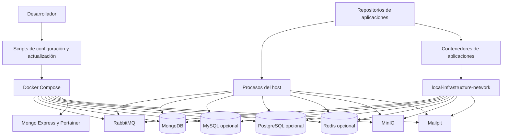

# Infraestructura Local
[English](README.en.md)

`local-infrastructure` es una capa de orquestación reutilizable para entornos de desarrollo locales. Proporciona servicios compartidos de Docker, configuración de entorno, utilidades de inicialización de repositorios y documentación operativa sin acoplar el entorno a una aplicación, organización o pila tecnológica concretas.

Los repositorios de aplicaciones se mantienen independientes. Pueden utilizar cualquier runtime y se almacenan localmente en `repositorios/` cuando se gestionan desde este espacio de trabajo.

## Descripción General

```text
Repositorios de aplicaciones
        |
        v
Infraestructura Local
        |
        +-- RabbitMQ
        +-- MongoDB
        +-- MinIO
        +-- Mailpit
        +-- Herramientas de desarrollo
```

La configuración Compose raíz ejecuta únicamente servicios compartidos de respaldo. Los contenedores de aplicaciones, el código fuente, los contextos de compilación y los comandos de los frameworks pertenecen a sus respectivos repositorios.

## Características

- Orquestación con Docker Compose para servicios locales compartidos
- Volúmenes persistentes de Docker para servicios con estado
- Enlaces de puertos exclusivamente locales
- Credenciales de desarrollo generadas y almacenadas en un archivo `.env` ignorado
- Flujo de configuración con Bash para WSL y Linux
- Clonación opcional de repositorios de aplicaciones en `repositorios/`
- Flujo seguro de actualización de Git para repositorios con ramas upstream configuradas
- Red compartida de Docker para aplicaciones en contenedores
- Comprobaciones de estado de servicio para RabbitMQ, MongoDB y MinIO
- MySQL, PostgreSQL y Redis opcionales para aplicaciones que necesiten SQL o caché

## Requisitos

- WSL o Linux con Bash
- Acceso a `sudo` y conectividad a Internet para una instalación automática inicial
- Ubuntu 22.04+ o Debian 12+, con glibc 2.35+ y arquitectura x86_64 o aarch64, para el PHP aislado de esta rama

El mismo flujo `setup-local.sh` se ejecuta en WSL y Linux. En Debian o Ubuntu, instala Git, Docker Engine y el complemento Docker Compose que falten, y después inicia Docker Engine. Si las herramientas ya existen, las valida sin reinstalar nada.

En esta rama, PHP se compila con una base fija `ubuntu:22.04`, no con la versión de la estación. El setup comprueba la distribución, glibc y arquitectura antes de descargar phpenv y termina con un mensaje claro si no son compatibles. Esto evita que una estación más reciente introduzca bibliotecas o compiladores incompatibles con PHP 8.3.6.

En Windows, instale primero una distribución WSL Debian o Ubuntu y ejecute la configuración dentro de ella. El script instala Docker Engine en esa distribución si falta; no utiliza un runtime de contenedores alojado en Windows. En esta rama también prepara PHP 8.3.6 con phpenv dentro de `enviroment/phpenv/`; no instala dependencias ni frameworks de aplicaciones.

## Estructura del Repositorio

```text
local-infrastructure/
├── .env.example
├── .gitattributes
├── .gitignore
├── AGENTS.md
├── README.en.md
├── README.md
├── docker-compose.yml
├── docker-compose.mysql.yml
├── docker-compose.postgres.yml
├── docker-compose.redis.yml
├── docs/
│   ├── application-repositories.md
│   ├── direct-upload-architecture.md
│   ├── internationalization.md
│   ├── local-services.md
│   └── timezone-handling.md
├── enviroment/
│   ├── activate.sh
│   ├── build-php.sh
│   ├── check-phpenv.sh
│   ├── copy-runtime-libraries.sh
│   ├── php-build.Dockerfile
│   └── setup-phpenv.sh
├── repositorios/
│   └── .gitkeep
├── setup-local.sh
└── update-local.sh
```

## Inicio Rápido

```bash
git clone <repository-url>
cd local-infrastructure
bash ./setup-local.sh
```

El script de configuración instala los requisitos previos del host que falten en las distribuciones compatibles, prepara PHP 8.3.6 con phpenv, valida el daemon de Docker, crea un archivo `.env` ignorado con credenciales locales generadas e inicia los servicios compartidos. Espera hasta que los servicios con comprobación de salud, incluido MinIO, estén saludables antes de informar éxito; si alguno falla, muestra el estado y conserva los volúmenes.

Para incluir servicios opcionales desde la primera ejecución en WSL, añada las opciones que necesite. Por ejemplo, para iniciar los tres:

```bash
bash ./setup-local.sh --with-mysql --with-postgres --with-redis
```

Cada opción (`--with-mysql`, `--with-postgres`, `--with-redis`) es independiente. El script valida la configuración Compose e inicia los seis servicios predeterminados más los seleccionados; no instala dependencias de aplicaciones.

### Instalaciones vacías y portables

En Linux o WSL, un despliegue con volúmenes nuevos inicia los servicios generales **sin datos de aplicaciones**: no importa bases de datos, colas, buckets, correos ni la configuración de Portainer de otro equipo. Solo se crean las cuentas y las bases iniciales propias de cada servicio. Son instancias compartidas por equipo, no contenedores por aplicación. Para preparar todos los servicios disponibles, use las tres opciones anteriores, sin `--repository`.

Cada equipo genera su propio `.env` privado y conserva después los datos en sus volúmenes locales. No copie `.env`, volúmenes, respaldos ni datos de proyectos para distribuir esta plantilla. Si Docker ya tiene volúmenes del mismo proyecto Compose, se reutilizan: **volver a ejecutar la configuración no los vacía**.

Los archivos Compose también pueden usarse directamente en Linux o dentro de WSL con Docker Engine y Compose v2 instalados, sin el runtime PHP de esta rama. Para ese flujo, prepare un `.env` privado a partir de `.env.example`, añada contraseñas aleatorias nuevas para las ocho variables de contraseña indicadas en [Configuración del Entorno](#configuración-del-entorno), restrinja sus permisos a `600` y use los comandos Compose de [Inicio del Entorno](#inicio-del-entorno). El setup automático de esta rama conserva su requisito adicional de Debian o Ubuntu para preparar PHP.

Si la configuración añade al usuario actual al grupo `docker`, abra una nueva sesión de WSL o Linux antes de ejecutar comandos de Docker sin `sudo`. Hasta entonces, use el comando de Docker que imprima la configuración.

Para clonar repositorios de aplicaciones durante la configuración, indique cada repositorio con un nombre de directorio local:

```bash
bash ./setup-local.sh \
  --repository backend=<git-url> \
  --repository frontend=<git-url> \
  --repository landing=<git-url>
```

Cada repositorio se clona en `repositorios/<name>`. El script no instala dependencias de aplicaciones ni inicia aplicaciones porque esas acciones dependen de la tecnología y las convenciones de cada repositorio.

### PHP 8.3.6 en esta rama

`setup-local.sh` instala phpenv, php-build y PHP 8.3.6 en `enviroment/phpenv/`. La carpeta está ignorada por Git. Compila PHP en un contenedor temporal basado en `ubuntu:22.04`, para la arquitectura de la estación, y copia las bibliotecas de ejecución que falten al entorno local; no reemplaza el PHP del sistema, no instala paquetes de desarrollo en el host ni modifica la configuración global de Bash. La compilación inicial puede tardar varios minutos. El contexto de construcción excluye los runtimes, logs y demás archivos locales de `enviroment/`.

La compilación utiliza dos procesos paralelos por defecto. En una estación con poca memoria, use `PHP_BUILD_JOBS=1 bash ./setup-local.sh` o `PHP_BUILD_JOBS=1 bash ./update-local.sh`. Los logs completos se conservan en `enviroment/phpenv/logs/php-8.3.6.*/`, incluso después de eliminar el contenedor. `build.log` contiene la salida y las versiones del compilador, libxml2 y OpenSSL; los archivos `php-build.*.log` conservan el diagnóstico del compilador. Ante un fallo, el script indica el directorio local y muestra los primeros errores encontrados. Revise esos logs antes de compartirlos.

Para usar la versión de esta rama en una terminal, actívela explícitamente:

```bash
source ./enviroment/activate.sh
php -v
# Ejecute aquí los comandos PHP de la aplicación.
deactivate_phpenv
```

La activación afecta solo a esa terminal. phpenv también instala Composer en este entorno, así que `composer install` usará el PHP seleccionado cuando se ejecute dentro del repositorio de cada aplicación. Cada aplicación conserva sus propias dependencias y archivos de entorno. Consulte [Repositorios de Aplicaciones](docs/application-repositories.md).

### Despliegue local de un repositorio PHP o Laravel

Este es un flujo de **desarrollo local**, no un despliegue de producción. Primero revise el `composer.json`, el `composer.lock` y el README de la aplicación para confirmar que sus dependencias admiten PHP 8.3.6 y saber qué servicios requiere. Laravel 8, si lo usa una aplicación, tuvo soporte oficial hasta PHP 8.1 y dejó de recibir correcciones de seguridad el 24 de enero de 2023. Esta rama no convierte Laravel 8 en compatible ni seguro para producción: registre esa brecha y planifique actualizar la aplicación antes de desplegarla fuera del entorno local. Consulte la [política de soporte de Laravel 8](https://laravel.com/docs/8.x/releases).

Una vez confirmada la compatibilidad, prepare los servicios desde la raíz y ejecute cada aplicación desde su propio repositorio:

```bash
# Una vez, desde la raíz de local-infrastructure:
bash ./setup-local.sh                 # Añada --with-mysql, --with-postgres o --with-redis si aplica.

# En cada terminal de trabajo, desde la raíz de local-infrastructure:
source ./enviroment/activate.sh
php -v
cd repositorios/NOMBRE_DEL_REPOSITORIO
# Configure el .env privado de esta aplicación según su README.
composer install
php artisan serve --host=127.0.0.1
```

Sustituya `NOMBRE_DEL_REPOSITORIO` por la carpeta real. `activate.sh` solo cambia el PHP de la terminal: no inicia contenedores ni instala dependencias de la aplicación. Si los servicios ya están preparados pero detenidos, ejecute `docker compose up -d` desde la raíz; incluya los archivos `-f` usados para servicios opcionales. Ejecute migraciones, pruebas, procesos de cola y comandos de frontend solo según la documentación de la aplicación. Si la aplicación corre en su propio contenedor, use el Compose de ese repositorio y la red compartida; no necesita activar el PHP del host. La guía completa está en [Flujo local de PHP y Laravel](docs/php-laravel-local-workflow.md).

## Configuración del Entorno

`.env.example` contiene configuración no sensible, como puertos locales, nombres de usuario de servicios y el nombre de la red Docker compartida. `setup-local.sh` lo copia a `.env` y añade contraseñas generadas. Si ya existe un `.env`, el script conserva sus valores y añade únicamente las variables opcionales que falten.

No versione `.env` en Git. Para regenerar las credenciales locales, restablezca los datos de los servicios locales, elimine `.env` y vuelva a ejecutar la configuración:

```bash
docker compose down --volumes
rm .env
bash ./setup-local.sh
```

Si inició servicios opcionales, incluya sus archivos `-f` en el primer comando para eliminar también sus volúmenes. Esto elimina permanentemente los datos locales: los servicios con estado aplican sus credenciales iniciales únicamente cuando se crean sus volúmenes de datos.

El archivo generado contiene valores de esta forma:

```env
RABBITMQ_PASSWORD=<generated-local-password>
MONGODB_PASSWORD=<generated-local-password>
MONGO_EXPRESS_PASSWORD=<generated-local-password>
MINIO_ROOT_PASSWORD=<generated-local-password>
MYSQL_PASSWORD=<generated-local-password>
MYSQL_ROOT_PASSWORD=<generated-local-password>
POSTGRES_PASSWORD=<generated-local-password>
REDIS_PASSWORD=<generated-local-password>
```

MinIO se inicia sin buckets ni reglas de ciclo de vida. Las aplicaciones crean y configuran los buckets que requieren.
Su imagen se descarga del registro público de Chainguard porque `minio/minio` ya no está disponible en Docker Hub. El control de salud consulta el endpoint HTTP con Bash; la imagen mínima no incluye `curl`.

## Primer Acceso y Credenciales

`setup-local.sh` crea `.env` únicamente cuando aún no existe. Copia los nombres de usuario locales configurados y genera las contraseñas necesarias. En un `.env` existente, solo añade las variables opcionales que falten. No se requiere crear cuentas manualmente para RabbitMQ, MongoDB, Mongo Express, MinIO, MySQL, PostgreSQL ni Redis en una configuración limpia.

Abra `.env` únicamente en un editor local de confianza cuando un servicio o una aplicación requiera sus credenciales. No imprima su contenido en una terminal, no lo comparta ni lo confirme en Git.

Flujo de la primera ejecución:

1. Ejecute `docker compose ps` y espere las comprobaciones de estado necesarias de los servicios. Si la configuración informó acceso temporal mediante `sudo`, use en su lugar el comando que imprimió.
2. Abra `https://localhost:9443` y cree la cuenta local de administrador de Portainer.
3. Utilice los valores correspondientes de `.env` al iniciar sesión en RabbitMQ, Mongo Express o MinIO, o al configurar un cliente de MongoDB o RabbitMQ.
4. Configure cada aplicación con los valores de servicios compartidos que necesite en el archivo de entorno ignorado propio de esa aplicación.

| Servicio | Primer acceso | Origen de las credenciales |
| --- | --- | --- |
| RabbitMQ | Inicie sesión en la UI de administración o configure un cliente AMQP. | `RABBITMQ_USERNAME` y `RABBITMQ_PASSWORD` en `.env` |
| MongoDB | Configure una aplicación o cliente con acceso autenticado a MongoDB. | `MONGODB_USERNAME` y `MONGODB_PASSWORD` en `.env` |
| Mongo Express | Inicie sesión mediante autenticación básica HTTP. | `MONGO_EXPRESS_USERNAME` y `MONGO_EXPRESS_PASSWORD` en `.env` |
| MinIO | Inicie sesión en la consola o configure un cliente compatible con S3. | `MINIO_ROOT_USER` y `MINIO_ROOT_PASSWORD` en `.env` |
| MySQL (opcional) | Configure un cliente SQL o una aplicación. | `MYSQL_USERNAME`, `MYSQL_PASSWORD`, `MYSQL_DATABASE` y `MYSQL_PORT` en `.env` |
| PostgreSQL (opcional) | Configure un cliente SQL o una aplicación. | `POSTGRES_USERNAME`, `POSTGRES_PASSWORD`, `POSTGRES_DATABASE` y `POSTGRES_PORT` en `.env` |
| Redis (opcional) | Configure un cliente de caché o de mensajes. | `REDIS_PASSWORD` y `REDIS_PORT` en `.env` |
| Mailpit | Abra la UI web o envíe correo mediante SMTP. | No hay autenticación configurada. |
| Portainer | Abra la UI HTTPS después del primer inicio y cree su cuenta local de administrador. | Se almacena en el volumen persistente `portainer_data`, no en `.env` |

Use marcadores de posición, nunca valores generados, al documentar la configuración de aplicaciones:

```text
amqp://<RABBITMQ_USERNAME>:<RABBITMQ_PASSWORD>@localhost:<RABBITMQ_AMQP_PORT>
mongodb://<MONGODB_USERNAME>:<MONGODB_PASSWORD>@localhost:<MONGODB_PORT>/?authSource=admin
mysql://<MYSQL_USERNAME>:<MYSQL_PASSWORD>@localhost:<MYSQL_PORT>/<MYSQL_DATABASE>
postgresql://<POSTGRES_USERNAME>:<POSTGRES_PASSWORD>@localhost:<POSTGRES_PORT>/<POSTGRES_DATABASE>
redis://:<REDIS_PASSWORD>@localhost:<REDIS_PORT>/0
```

Los repositorios de aplicaciones son propietarios de sus archivos de entorno. Configure los valores de servicios compartidos en el archivo de entorno local ignorado de cada aplicación según sea necesario; este repositorio no copia automáticamente las credenciales de infraestructura en las aplicaciones.

## Inicio del Entorno

Después de la configuración inicial, inicie todos los servicios compartidos con:

```bash
docker compose up -d
```

Inspeccione el estado y los registros con:

```bash
docker compose ps
docker compose logs -f
```

### Servicios opcionales

Para incluir MySQL, PostgreSQL y Redis al preparar una estación nueva, ejecute `bash ./setup-local.sh --with-mysql --with-postgres --with-redis`. Omita las opciones que no necesite. Si ya ejecutó la configuración, puede iniciar las extensiones genéricas posteriormente; por ejemplo, para los tres servicios:

```bash
docker compose -f docker-compose.yml -f docker-compose.mysql.yml -f docker-compose.postgres.yml -f docker-compose.redis.yml config --quiet
docker compose -f docker-compose.yml -f docker-compose.mysql.yml -f docker-compose.postgres.yml -f docker-compose.redis.yml up -d
docker compose -f docker-compose.yml -f docker-compose.mysql.yml -f docker-compose.postgres.yml -f docker-compose.redis.yml ps
```

Cada extensión tiene su propio volumen persistente y publica su puerto solo en `127.0.0.1`. MySQL y PostgreSQL crean la base de datos local indicada en `.env`; Redis exige contraseña y conserva los datos con AOF. Las aplicaciones en WSL usan `localhost` y el puerto configurado; los contenedores unidos a `LOCAL_INFRA_NETWORK` usan `mysql:3306`, `postgres:5432` o `redis:6379`. Copie las credenciales necesarias al archivo de entorno privado de cada aplicación; no se transfieren automáticamente. Cada aplicación gestiona sus migraciones y debe usar bases de datos y usuarios separados si comparte un servidor SQL con otras.

Al consultar, actualizar o detener la pila, incluya `-f docker-compose.yml` y **todos** los archivos opcionales con los que inició los servicios. El Compose raíz por sí solo sigue administrando únicamente los seis servicios predeterminados. No añada contenedores de aplicaciones ni dependencias de sus frameworks aquí.
Si vuelve a ejecutar `setup-local.sh`, repita las opciones de todos los servicios opcionales que ya estén activos para mantenerlos en la misma operación Compose.
Para dejar de usar una extensión, detenga primero la pila con todos sus archivos `-f` (sin `--volumes` si desea conservar los datos) y reiníciela solo con las opciones que necesite.

## Persistencia de los Servicios

RabbitMQ, MongoDB, MinIO, Mailpit y Portainer tienen volúmenes propios; también MySQL, PostgreSQL y Redis cuando se seleccionan. Mongo Express es una interfaz sin datos propios: administra los de MongoDB. Mailpit usa `mailpit_data` y `MP_DATABASE=/data/mailpit.db` para conservar sus correos al recrear el contenedor, sujeto a su retención (500 mensajes por defecto).

Mantenga `COMPOSE_PROJECT_NAME` y los nombres de los volúmenes al actualizar o mover esta carpeta en el mismo equipo. Cambiar el proyecto puede seleccionar volúmenes nuevos y hacer que los servicios parezcan vacíos; no migra ni elimina los anteriores. Los volúmenes no se transfieren mediante Git ni sustituyen a los respaldos.

**Antes de actualizar una instalación anterior:** RabbitMQ debe conservar su identidad. Si usaba un hostname generado por Docker, configure ese hostname anterior en `RABBITMQ_HOSTNAME` dentro del `.env` privado antes de recrearlo; el nuevo valor predeterminado `rabbitmq` es para instalaciones nuevas. Cambiarlo con datos existentes puede hacer que RabbitMQ no encuentre su estado anterior. Un Mailpit anterior sin almacenamiento persistente requiere guardar o migrar sus correos localmente antes de recrearlo si desea conservarlos; el nuevo volumen no los recupera automáticamente. No regenere credenciales si reutiliza datos existentes.

Consulte el [inventario de volúmenes y las precauciones de actualización](docs/local-services.md#persistence-and-existing-installations) antes de ejecutar setup, update o una recreación sobre una instalación existente.

## Detención del Entorno

Detenga los contenedores conservando los volúmenes de datos:

```bash
docker compose down
```

Si usa servicios opcionales, incluya sus archivos `-f` al ejecutar `down` o `down --volumes` para detenerlos y, si corresponde, eliminar sus datos.

Para eliminar permanentemente todos los datos de los servicios locales:

**Esta operación es destructiva y no es necesaria para instalar la plantilla en otro equipo.**

```bash
docker compose down --volumes
```

## Actualización de Imágenes de Servicios

Este repositorio no compila imágenes de aplicaciones. Actualice las imágenes de infraestructura configuradas con:

```bash
docker compose pull
docker compose up -d
```

Use `docker compose up -d --force-recreate` cuando los cambios de configuración requieran recrear los contenedores.

## Actualización de Repositorios de Aplicaciones

Actualice los repositorios limpios en `repositorios/` en la rama actualmente activa:

```bash
bash ./update-local.sh
```

El script obtiene actualizaciones remotas y realiza avance rápido en los repositorios con una rama upstream configurada. Omite repositorios con cambios locales, commits solo locales, historial divergente, HEAD separados o configuración upstream faltante. Después valida Compose y concilia los servicios compartidos con la configuración de esta rama, esperando a que estén listos. Esto aplica también la imagen y el control de salud actuales de MinIO sin eliminar su volumen.

Si utiliza servicios opcionales, repita las opciones correspondientes al actualizar: `bash ./update-local.sh --with-mysql --with-postgres --with-redis`. Para actualizar solo los repositorios sin iniciar servicios, use `--skip-services`. La actualización necesita el `.env` de infraestructura generado por `setup-local.sh`, salvo cuando se omiten los servicios.

En esta rama, el script comprueba primero que el PHP aislado de `enviroment/phpenv/` funcione y sea exactamente 8.3.6. Si falta, no se puede ejecutar o tiene una versión incorrecta, intenta instalarlo o reconstruirlo mediante `enviroment/setup-phpenv.sh` y vuelve a comprobarlo antes de actualizar repositorios o servicios. Una instalación válida no se reinstala. La reparación requiere Git, Docker Engine accesible y un sistema compatible con los requisitos de PHP indicados arriba, incluso con `--skip-services`; puede tardar varios minutos.

Antes de reemplazar una instalación existente, se conserva un respaldo en `enviroment/phpenv/.php-8.3.6-backup.*/previous`. Si la reparación falla, se intenta restaurar ese respaldo y la actualización se detiene; cualquier instalación fallida se conserva en el mismo directorio de respaldo. Si tiene éxito, el respaldo anterior también se conserva. No modifica el PHP del sistema ni otras versiones de phpenv, y no instala dependencias de aplicaciones. La versión requerida sigue siendo 8.3.6; los repositorios de aplicaciones deben mantener requisitos compatibles. `--force` sigue afectando únicamente a la sincronización de repositorios y no es necesario para reparar PHP.

En una estación de trabajo nueva, clone esta rama y ejecute primero `bash ./setup-local.sh` para preparar los requisitos y el entorno local. Después utilice `bash ./update-local.sh` para las actualizaciones. No copie `.env` ni `enviroment/phpenv/` de otra máquina: las credenciales se generan localmente y PHP se compila para la arquitectura de destino con la base controlada.

Use `--force` únicamente cuando los cambios locales puedan descartarse. Restablece los repositorios afectados a su rama upstream y elimina archivos sin seguimiento:

```bash
bash ./update-local.sh --force
```

## Servicios

| Servicio | Propósito | Endpoint local | Autenticación |
| --- | --- | --- | --- |
| RabbitMQ | Broker de mensajes y UI de administración | `amqp://localhost:5672`, `http://localhost:15672` | Credenciales de RabbitMQ en `.env` |
| MongoDB | Base de datos documental | `mongodb://localhost:27017` | Credenciales de MongoDB en `.env` |
| Mongo Express | Administración web de MongoDB | `http://localhost:8081` | Credenciales de Mongo Express en `.env` |
| MinIO | Almacenamiento de objetos compatible con S3 y consola | `http://localhost:9000`, `http://localhost:9001` | Credenciales de MinIO en `.env` |
| Mailpit | Servidor SMTP de desarrollo y visor de correos electrónicos | SMTP `localhost:1025`, `http://localhost:8025` | Ninguna |
| Portainer | Administración del entorno Docker | `http://localhost:9002`, `https://localhost:9443` | Cree un administrador local en el primer acceso |
| MySQL (opcional) | Base de datos relacional compartida | `mysql://localhost:3306` | Credenciales de MySQL en `.env` |
| PostgreSQL (opcional) | Base de datos relacional compartida | `postgresql://localhost:5432` | Credenciales de PostgreSQL en `.env` |
| Redis (opcional) | Caché y mensajería en memoria | `redis://localhost:6379` | Contraseña de Redis en `.env` |

Todos los puertos se enlazan a `127.0.0.1` y pueden cambiarse en `.env` antes del inicio.

## Arquitectura



Las aplicaciones ejecutadas en el host se conectan mediante `localhost`. Las aplicaciones en contenedores pueden unirse a la red Docker compartida y usar nombres de servicios de Compose como `rabbitmq`, `mongo`, `minio` y `mailpit`.
Si se inician las extensiones opcionales, los nombres `mysql`, `postgres` y `redis` también estarán disponibles en esa red.

## Trabajo con Repositorios de Aplicaciones

Los repositorios de aplicaciones son repositorios Git normales ubicados directamente en `repositorios/`; no son submódulos. Cada repositorio es propietario de sus ramas, dependencias, configuración de entorno, pruebas y comandos de desarrollo.

En esta línea de trabajo, cree ramas de tarea. Nunca haga commits directos en `main` ni en `develop` y nunca abra un PR dirigido a esas ramas, tanto aquí como en los repositorios de aplicaciones. Verifique siempre el destino del PR y siga las [reglas de ramas, MVC y seguridad](docs/php-laravel-local-workflow.md).

Para una aplicación en contenedor, únase a la red configurada por `LOCAL_INFRA_NETWORK`:

```yaml
networks:
  local-infrastructure:
    external: true
    name: local-infrastructure-network
```

Conecte el servicio de la aplicación a esa red. De esta forma podrá resolver los nombres de servicios compartidos de `docker-compose.yml`. Consulte [Repositorios de Aplicaciones](docs/application-repositories.md) para conocer los detalles de integración en host y contenedores.

## Comandos Habituales

| Comando | Descripción |
| --- | --- |
| `bash ./setup-local.sh` | Genera la configuración local e inicia los servicios compartidos. |
| `bash ./setup-local.sh --with-mysql` | Además, valida e inicia MySQL opcional en la primera ejecución. |
| `bash ./setup-local.sh --with-postgres --with-redis` | Inicia PostgreSQL y Redis opcionales junto con los servicios predeterminados. |
| `bash ./setup-local.sh --repository name=<git-url>` | Clona un repositorio en `repositorios/name` e inicia los servicios compartidos. |
| `bash ./update-local.sh` | Actualiza los repositorios aptos y concilia los servicios compartidos, esperando a que estén listos. |
| `bash ./update-local.sh --skip-services` | Actualiza repositorios sin iniciar servicios. |
| `bash ./update-local.sh --force` | Restablece los repositorios aptos a su rama upstream y descarta el trabajo local. |
| `docker compose up -d` | Inicia los servicios compartidos. |
| `docker compose down` | Detiene los servicios compartidos y conserva los volúmenes. |
| `docker compose down --volumes` | Detiene los servicios y elimina los datos locales persistentes. |
| `docker compose ps` | Muestra el estado y la salud de los servicios. |
| `docker compose logs -f` | Sigue los registros de los servicios. |
| `docker compose pull` | Descarga las imágenes actualizadas de los servicios configurados. |
| `docker compose -f docker-compose.yml -f docker-compose.mysql.yml up -d` | Inicia la pila con MySQL opcional. |

## Solución de Problemas

| Problema | Resolución |
| --- | --- |
| Docker Engine no está disponible | El script de configuración intenta iniciarlo. Si falla, inicie Docker Engine en el entorno actual de WSL o Linux y confirme que `docker info` se ejecute correctamente. |
| El aprovisionamiento automático no está disponible | Use Debian o Ubuntu, o instale Git, Docker Engine, Docker Compose v2, `od` y `tr` antes de ejecutar la configuración en otra distribución de Linux. |
| Un servicio no puede enlazar su puerto | Cambie la variable de puerto correspondiente en `.env` y ejecute `docker compose up -d`. |
| Compose informa de una variable de entorno faltante | Ejecute `bash ./setup-local.sh` para crear `.env`, o restaure el valor local necesario sin confirmarlo en Git. |
| Falla la compilación o reparación de PHP | Revise el directorio `enviroment/phpenv/logs/php-8.3.6.*` indicado por el script, especialmente `build.log` y `php-build.*.log`. Confirme glibc 2.35+ y una arquitectura compatible. Con poca memoria, reintente solo PHP con `PHP_BUILD_JOBS=1 bash ./enviroment/setup-phpenv.sh`; requiere Git y Docker disponibles y no actualiza repositorios ni inicia servicios. No desinstale el PHP del sistema. |
| MinIO no inicia o no queda saludable | Revise `docker compose ps minio` y `docker compose logs minio`. Confirme que se usa `cgr.dev/chainguard/minio:latest`; ejecute de nuevo `bash ./setup-local.sh` o `bash ./update-local.sh` para aplicar la configuración actual sin borrar `minio_data`. |
| Mongo Express espera a MongoDB | Ejecute `docker compose ps` y espere hasta que MongoDB esté saludable. Inspeccione `docker compose logs mongo` si no llega a estar saludable. |
| MySQL no acepta conexiones | Inicie la pila con ambos archivos Compose, compruebe su salud con `docker compose -f docker-compose.yml -f docker-compose.mysql.yml ps` y revise que el puerto de `.env` esté disponible. No cambie las credenciales sin restablecer también el volumen de MySQL. |
| PostgreSQL o Redis no aceptan conexiones | Confirme que incluyó el archivo Compose correspondiente, revise su estado con los mismos archivos `-f` y compruebe que los puertos locales estén disponibles. Las credenciales iniciales de PostgreSQL no cambian en un volumen existente. |
| Un contenedor de aplicación no puede resolver un servicio compartido | Conecte el servicio Compose de la aplicación a `local-infrastructure-network`. |
| Los datos locales necesitan un restablecimiento limpio | Ejecute `docker compose down --volumes` con todos los archivos `-f` de los servicios que utilizó y después `bash ./setup-local.sh` con las opciones deseadas. Esto elimina permanentemente los datos de infraestructura local. |
| Se omite la actualización de un repositorio | Resuelva los cambios locales, configure una rama upstream o use `--force` solo después de confirmar que el trabajo local puede descartarse. |

## Seguridad

- Nunca versione `.env`, credenciales generadas, tokens ni URL de repositorios privados en Git.
- Mantenga `.env.example` limitado a valores predeterminados y marcadores de posición no sensibles.
- Use las credenciales generadas únicamente para desarrollo local.
- Enlace los servicios a localhost salvo que un requisito de desarrollo deliberado indique lo contrario.
- En WSL, mantenga el repositorio en el sistema de archivos de Linux cuando sea necesario aplicar permisos locales a los archivos.
- Use un gestor de secretos y controles de acceso específicos de producción fuera del desarrollo local.
- En aplicaciones Laravel, valide entradas, autorice cada recurso, proteja formularios con CSRF y revise dependencias; consulte la [guía de seguridad y MVC](docs/php-laravel-local-workflow.md).

## Adición de un Nuevo Proyecto

Clone o cree un repositorio en `repositorios/`:

```text
local-infrastructure/
├── repositorios/
│   ├── backend/
│   ├── frontend/
│   └── worker/
└── docker-compose.yml
```

Inicie la aplicación con su propia documentación. Para las aplicaciones que se ejecutan en el host, configure los endpoints de los servicios locales de la tabla [Servicios](#servicios). Para los contenedores de aplicaciones, únase a la red Docker compartida.

## Documentación

- [Servicios Locales](docs/local-services.md)
- [Repositorios de Aplicaciones](docs/application-repositories.md)
- [Flujo local de PHP y Laravel: ramas, MVC y seguridad](docs/php-laravel-local-workflow.md)
- [Arquitectura de Carga Directa](docs/direct-upload-architecture.md)
- [Internacionalización](docs/internationalization.md)
- [Gestión de Zonas Horarias](docs/timezone-handling.md)

## Contribución

1. Cree una rama de tarea. No haga commits directos en `main` o `develop` ni abra PR dirigidos a esas ramas; seleccione la rama de integración autorizada para esta línea de trabajo.
2. Realice cambios de infraestructura concretos y genéricos.
3. Valide la sintaxis de shell y la configuración de Compose.
4. Actualice la documentación cuando cambie el comportamiento.
5. Abra una solicitud de incorporación de cambios con los resultados de la verificación.
